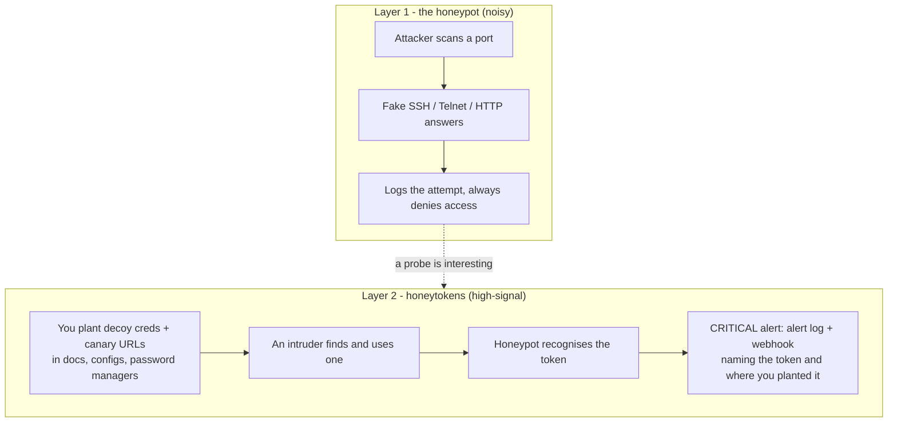

# Honeypot + Honeytokens (Linux & Windows)

A decoy that listens on ports attackers probe (SSH, Telnet, HTTP), pretends to be the real service, and logs every attempt — plus a **honeytoken** system: decoy credentials and canary URLs you plant around your environment. Nothing legitimate ever touches a honeytoken, so any hit is a high-confidence intrusion signal that raises a **critical alert** to a log and an optional webhook.

It **never grants access** and **never runs anything a client sends**. One cross-platform Python program (3.8+, with `paramiko` as the only dependency, used for real SSH capture), plus hardened service installers for each OS.

This extends a minimal fake-SSH script into something you can actually deploy. See [what changed](#what-changed).

## Two layers



- **Layer 1** catches internet background noise and scanners. Useful, but noisy.
- **Layer 2** is the point of this build. A honeytoken only fires when someone uses a decoy they could only have found by snooping, so it has almost no false positives. That's what you want paging you at 3am.

## Honeytokens

Manage them with `honeytokens.py`. Three types:

| Type | What it is | Where you plant it | Fires when |
| --- | --- | --- | --- |
| **credential** | A fake username/password | A password manager entry, a config file, a wiki page ("ssh admin@\<honeypot\>") | Someone tries it at the honeypot's fake login (SSH/Telnet or HTTP basic-auth) |
| **web** | A unique canary URL `http://<honeypot>/t/<id>` | A hidden link in a document, a spreadsheet cell, a DNS record, a fake API endpoint in source | Anyone requests that URL |
| **file** | A decoy file (e.g. `aws_credentials.txt`) with an embedded canary URL | A file share, a home directory, a repo | The file is opened/exfiltrated and the embedded URL is fetched; the honeypot serves the file's content so the fetch looks real |

Create some:

```bash
# a fake credential to drop in your password vault
python3 honeytokens.py -c config.json new credential --label "fake DB admin" --planted-at "vault: infra"

# a canary URL to paste into a tempting document
python3 honeytokens.py -c config.json new web --label "link in budget.xlsx" --base-url http://your-honeypot:8080

# a decoy AWS-keys file (written into the decoy folder) with an embedded canary
python3 honeytokens.py -c config.json new file --name aws_credentials.txt --label "keys on fileserver" --base-url http://your-honeypot:8080

python3 honeytokens.py -c config.json list
python3 honeytokens.py -c config.json revoke <id>
```

Tokens live in `state_dir` (`tokens.json` + a `decoys/` folder). The running honeypot reloads the file automatically, so new tokens take effect **without a restart** (verified in the tests).

## Alerts

When a token fires, the honeypot writes a critical record to `alerts.log` (separate from the noisy activity log) and, if `webhook_url` is set, POSTs the alert as JSON:

```json
{"ts":"2026-11-05T16:…","severity":"critical","kind":"honeytoken_triggered",
 "token_id":"a1b2c3d4e5f6a7b8","token_type":"credential","label":"fake DB admin",
 "planted_at":"vault: infra","via":"credential","service":"ssh",
 "src_ip":"203.0.113.9","src_port":51514,"username":"dbadmin","password":"…"}
```

Point `webhook_url` at a Slack/Teams incoming webhook, a SIEM HTTP collector, or your own handler. The POST runs on a background thread with a short timeout, so a slow endpoint never stalls the honeypot, and critical alerts are never rate-limited.

## Quick start (try it locally)

```bash
python3 honeytokens.py -c config.example.json new credential --username dbadmin --password S3cr3tDecoy
python3 honeypot.py -c config.example.json
```

From another terminal, act like an intruder who found that credential:

```bash
printf 'dbadmin\nS3cr3tDecoy\n' | nc 127.0.0.1 2323
```

Watch the console print `!!! [ALERT:critical] honeytoken_triggered` and check `alerts.log`.

## Install as a service

### Linux (systemd)

```bash
sudo bash linux/install.sh
```

Installs to `/opt/honeypot`, config to `/etc/honeypot/config.json`, logs to `/var/log/honeypot`, tokens and decoys to `/var/lib/honeypot`, running as a dedicated unprivileged `honeypot` user under a locked-down unit (`NoNewPrivileges`, `ProtectSystem=strict`, syscall filter, no capabilities, memory/task caps). Plant tokens as the service user:

```bash
sudo -u honeypot python3 /opt/honeypot/honeytokens.py -c /etc/honeypot/config.json new web --base-url http://your-host:8080
systemctl status honeypot ; journalctl -u honeypot -f
sudo bash linux/uninstall.sh
```

### Windows (Scheduled Task)

From an **elevated** PowerShell:

```powershell
powershell -ExecutionPolicy Bypass -File windows\install.ps1 -OpenFirewall
```

Installs to `C:\ProgramData\Honeypot`, runs at boot under the low-privilege **LOCAL SERVICE** account, opens the ports (with `-OpenFirewall`). Manage tokens:

```powershell
python "C:\ProgramData\Honeypot\honeytokens.py" -c "C:\ProgramData\Honeypot\config.json" list
powershell -ExecutionPolicy Bypass -File windows\uninstall.ps1
```

The example config also defines FTP (21), SMTP (25), DNS (53, TCP only), HTTP (80), HTTPS (443), SMB (445), RDP (3389), MySQL (3306), PostgreSQL (5432), Redis (6379), MongoDB (27017), Elasticsearch (9200), VNC (5900), LDAP (389) and NFS (2049). A port that can't be bound is reported at startup and skipped, and the rest still run, so check the startup output.

- **Low ports (21/25/53/80/389/443/445):** the hardened Linux unit has no capabilities, so these won't bind. Redirect them at the firewall to a high port, or remove them from the config. To impersonate 22/23 the same way, move your real SSH first so you don't lock yourself out (the installer prints the command).
- **Ports your machine already uses:** a real service keeps its port and the fake one is skipped. On Windows that normally includes 445.
- **Firewall:** `-OpenFirewall` only opens 2222/2323/8080 unless you pass `-Ports`.
- **TLS:** with paramiko's `cryptography` dependency installed, a self-signed certificate is generated once in `state_dir` and used by HTTPS, SMTP STARTTLS, MySQL, PostgreSQL and RDP. Set `tls_cert` and `tls_key` to use your own. Without any certificate, those services don't offer TLS and 443 refuses the handshake.
- **What each protocol can capture:** honeytoken credentials can fire on SSH, Telnet, FTP, SMTP, HTTP basic auth, MySQL, Redis, PostgreSQL and LDAP, where the password arrives readable. MongoDB, SMB and VNC only reveal a username and/or challenge response. RDP reveals a username at most.
- **Persona:** the example config presents one Ubuntu 20.04 host (OpenSSH 8.2, Apache 2.4.41, vsftpd 3.0.3, Postfix) alongside Windows Server 2019-style RDP, SMB and LDAP. Change hostnames and domains so they suit your network. Real hosts rarely run all of these at once, so remove services you don't need.
- **Timing:** `response_delay_ms` adds a small random pause before each reply and `auth_fail_delay` adds the pause real servers make after a failed login.
- **SSH:** real clients complete a genuine key exchange through [paramiko](https://www.paramiko.org/) (`pip install -r requirements.txt`; the installers handle this). Passwords and public-key fingerprints are logged, and every login is refused. Host keys are created once in `state_dir`, so they stay the same across restarts. The server offers OpenSSH 8.2's algorithms in its order, minus those paramiko can't perform (`chacha20-poly1305`, `umac`, `hmac-sha1-etm`, `diffie-hellman-group18`, the `ssh-rsa` host key), so a detailed handshake comparison can still tell it apart. Without paramiko the honeypot still runs and only fingerprints real clients (version and HASSH).

## Files

```text
honeypot/
├── honeypot.py          listeners + token detection + alerting
├── honeytokens.py       CLI: create / list / revoke tokens, plant decoy files
├── tokens.py            the honeytoken store (shared, auto-reloading)
├── alerts.py            alert log + webhook dispatch
├── protocols.py         fake FTP, SMTP, DNS, TLS, SMB, RDP, database, VNC, LDAP, NFS dialogues
├── config.example.json  all settings, documented inline
├── linux/               install.sh, uninstall.sh, honeypot.service
├── windows/             install.ps1, uninstall.ps1
├── tests/test_honeypot.py
└── (created at runtime)  logs, state/tokens.json, state/decoys/
```

## Configuration highlights

| Key | Meaning |
| --- | --- |
| `services[]` | Which fake services run, on which ports, in which `mode` (`login`, `http`, `banner`, `ftp`, `smtp`, `dns`, `https`, `smb`, `rdp`, `mysql`, `postgres`, `redis`, `mongodb`, `vnc`, `ldap`, `nfs`) |
| `webhook_url` | POST critical alerts here (null = alert log only) |
| `state_dir` / `token_store` / `decoy_dir` | Where honeytokens and decoy files live |
| `max_connections`, `conn_timeout`, `conn_lifetime`, `max_line_bytes`, `max_conn_bytes` | Resource caps that stop the honeypot itself being flooded |
| `log_max_bytes`, `log_backups` | Log rotation (both activity and alert logs) |
| `drop_privileges_to` | Linux: drop to this user if started as root (e.g. after binding low ports) |

## Tests

```bash
python3 tests/test_honeypot.py
python3 tests/test_protocols.py
python3 tests/test_ssh.py       # needs paramiko; skipped without it
```

`test_ssh.py` logs in with a real SSH client and checks capture, refusal, honeytoken alerts and stable host keys. `test_protocols.py` speaks each new protocol over a raw socket and covers login-parsing edge cases. `test_honeypot.py` has 16 checks, stable across repeated runs. They plant all three token types with the CLI, run a local webhook receiver, then attack: fake services respond and never grant access; over-long input is bounded (the DoS fix); a credential token fires via SSH **and** via HTTP basic-auth; a canary URL fires and returns believable content; a decoy-file URL serves the planted file; a normal `root`/`hunter2` login and a normal probe raise **no** alert; and all four triggers reach both the alert log and the webhook. A separate check confirms a token planted while the honeypot is running is detected without a restart.

## What changed

From the original fake-SSH script to this:

| Area | Original | This version |
| --- | --- | --- |
| Honeytokens | none | credential, web and file tokens with a CLI and a live-reloading store |
| Alerting | none | separate critical alert log + background webhook POST |
| Services | SSH only | SSH, Telnet, HTTP, all configurable |
| DoS resistance | unbounded line read; unlimited threads | byte caps per line/connection; global connection ceiling |
| Logging | freeform `repr` | one JSON object per event, with rotation |
| Console safety | raw attacker input | control characters stripped |
| Deployment | manual run | hardened systemd service and Windows scheduled task, both unprivileged |
| Shutdown | Ctrl-C only | clean SIGTERM/SIGINT so `systemctl stop` works |

## Scope and safe use

- Run it only on systems you own or are authorised to test. Recording connections may be regulated where you are; check first.
- Captured credentials are evidence, not a store to reuse.
- This is a **low-interaction** honeypot: it records attempts and token hits, it does not give attackers a real shell. For a fake shell to watch post-login behaviour, see [Cowrie](https://github.com/cowrie/cowrie) or [OpenCanary](https://github.com/thinkst/opencanary); the hosted [Canarytokens](https://canarytokens.org) project is the same honeytoken idea as a service. Map what you capture to MITRE ATT&CK, e.g. T1110 (Brute Force), T1021 (Remote Services), T1552 (Unsecured Credentials).
